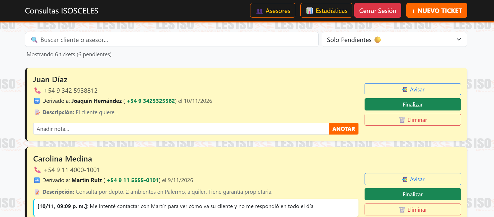
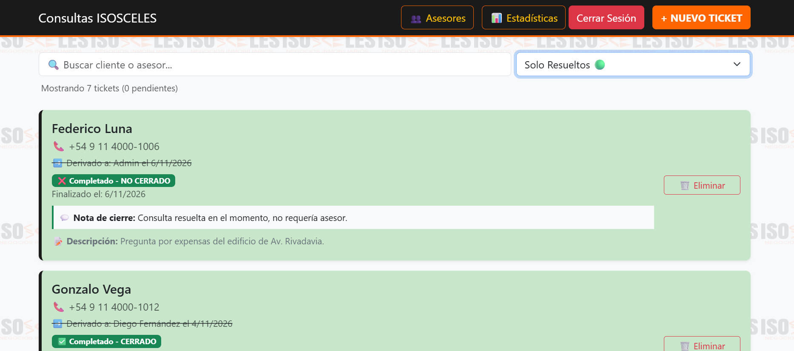
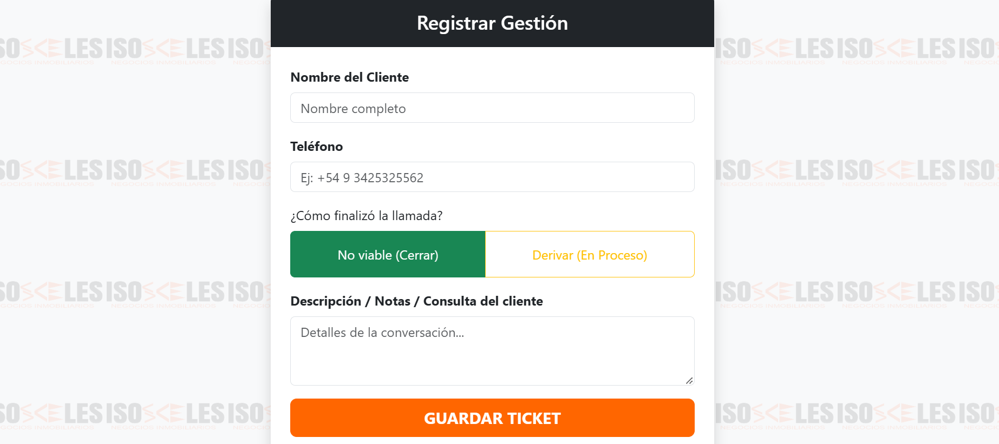
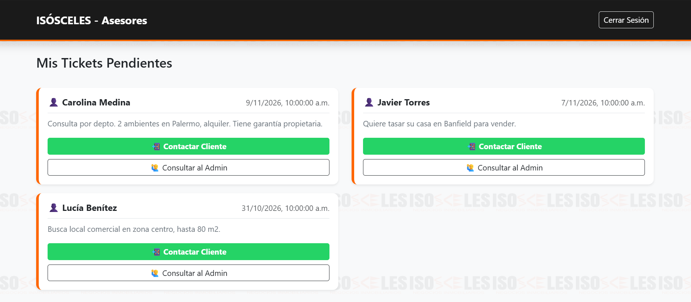

# Isósceles Tickets

Sistema web de gestión de consultas (tickets) para una inmobiliaria. El administrador registra cada consulta que llega, la deriva a un asesor (con aviso por WhatsApp) y hace el seguimiento hasta su cierre. Cada asesor ve solo sus tickets pendientes.

> Desarrollado y entregado a una inmobiliaria real. Este repositorio es una **versión de portfolio**: no está conectado a la base de datos del cliente y trae datos ficticios para probarlo en local.

## Capturas

| Panel del administrador | Tickets finalizados |
|---|---|
|  |  |
| **Login (modo demo)** | **Reportes por asesor** |
|  |  |

## Funcionalidades

- **Login con roles** (admin / asesor) usando Firebase Authentication.
- **Panel de tickets** en tiempo real: búsqueda, filtro por estado, alerta para tickets con más de 7 días pendientes, notas de seguimiento.
- **Alta de consultas**: cierre directo o derivación a un asesor y a uno de sus teléfonos, con mensaje de WhatsApp pre-armado.
- **Cierre de tickets** indicando si la operación se concretó o no, con nota de cierre.
- **Gestión de asesores**: alta de usuarios (sin cerrar la sesión del admin), edición de teléfonos, reseteo de contraseña y baja.
- **Reportes mensuales** por asesor (gestiones y efectividad) exportables a Excel.
- **Vista de asesor**: solo sus tickets en proceso, con acceso directo al WhatsApp del cliente y del admin.
- **Reglas de seguridad de Firestore** por rol: el asesor solo puede leer los tickets asignados a él.

## Stack

HTML + Bootstrap 5 + JavaScript (ES Modules) · Firebase Authentication · Cloud Firestore · Firebase Hosting · SweetAlert2 · SheetJS (export a Excel)

## Probarlo en local (2 comandos)

Usa el [Firebase Emulator Suite](https://firebase.google.com/docs/emulator-suite): **no hace falta cuenta de Google ni crear un proyecto**, todo corre en tu máquina.

Requisitos: [Node.js 18+](https://nodejs.org) y [Java 11+](https://adoptium.net) (lo necesita el emulador de Firestore).

```bash
npm install
npm run dev
```

Cuando la consola muestre `✅ Datos demo cargados`, abrí **http://localhost:5000/login.html** y usá los botones de acceso rápido:

| Rol    | Email             | Contraseña |
|--------|-------------------|------------|
| Admin  | `admin@demo.com`  | `demo1234` |
| Asesor | `asesor@demo.com` | `demo1234` |

Los datos se reinician cada vez que levantás `npm run dev`. En http://localhost:4000 está la UI de los emuladores para ver los usuarios y documentos creados.

> Los mails de "Resetear clave" no se envían: el emulador de Auth muestra el link en la consola.

## Estructura

```
├── login.html          # Login y redirección según rol
├── index.html          # Panel del admin (tickets)
├── nuevo.html          # Alta de consulta / derivación
├── empleados.html      # Gestión de asesores
├── reportes.html       # Reportes mensuales + export a Excel
├── vistaEmpleado.html  # Vista del asesor
├── js/
│   ├── firebase-config.js  # Configuración (proyecto demo por defecto)
│   └── firebase.js         # Inicialización única + conexión a emuladores
├── scripts/seed.js     # Carga usuarios y tickets ficticios
├── firestore.rules     # Reglas de seguridad por rol
└── firebase.json       # Hosting + emuladores
```

## Modelo de datos

- `empleados/{uid}`: `nombre`, `email`, `telefonos[]`, `rol` (`admin` | `empleado`), `fechaAlta`
- `tickets/{id}`: `cliente_nombre`, `cliente_telefono`, `descripcion`, `estado` (`EN_PROCESO` | `FINALIZADO`), `empleado_id`, `empleado_nombre`, `empleado_telefono`, `comentarios[]`, `resultado_cierre`, `resolucion`, `fecha_creacion`, `fecha_cierre`

